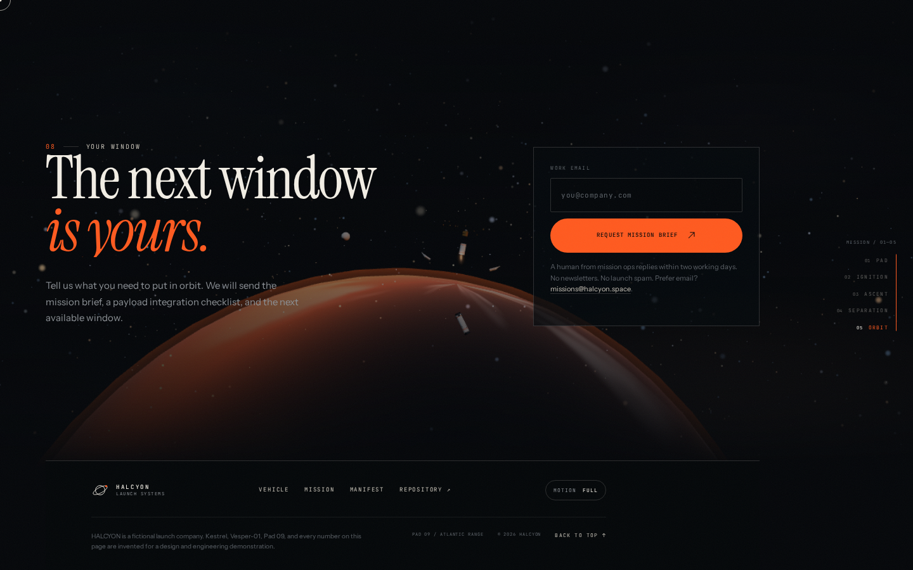
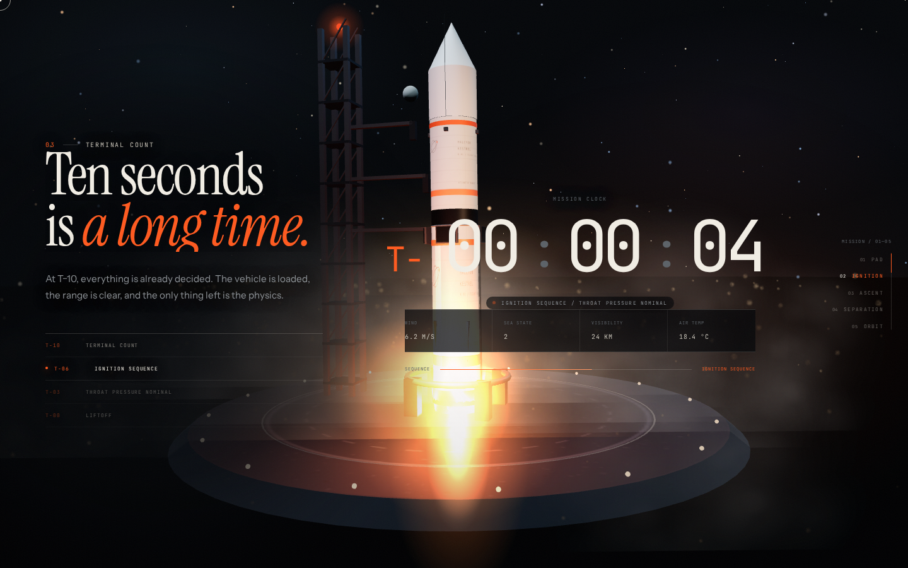
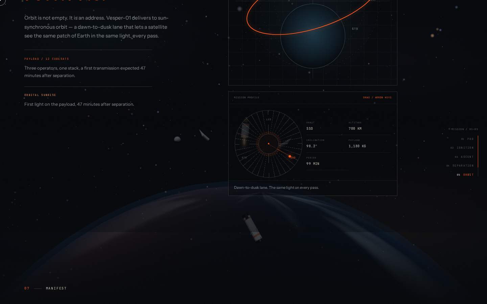

<div align="center">
  
  <h1>HALCYON</h1>
  <p><strong>The last quiet before orbit.</strong></p>
  <p>A scroll-driven mission page for a fictional reusable launch vehicle.</p>
  <p>
    <a href="https://gerrcass.github.io/scroll-to-orbit/"><strong>Live site ↗</strong></a>
    &nbsp;·&nbsp;
    <a href="https://github.com/gerrcass/scroll-to-orbit/issues/1">Spec</a>
    &nbsp;·&nbsp;
    <a href="docs/discovery/grill-session.md">Design brief</a>
    &nbsp;·&nbsp;
    <a href="docs/evidence/">Evidence</a>
  </p>
  <p>
    
    
  </p>
</div>



## The story

One persistent WebGL stage, five acts, one camera. The page follows **Vesper-01**, the first night flight of Halcyon's **Kestrel** vehicle, from the hush of Pad 09 to the first light of orbit.

| Act | Scroll | The scene | The document |
| --- | --- | --- | --- |
| **01 · Pad** | 0–18% | Kestrel waits under floodlights, a star field and a slow camera drift. | Hero, thesis, drawn vehicle schematic and recovery profile. |
| **02 · Ignition** | 18–30% | Flame shaders, smoke volume, engine light, camera shake; the pad starts to fall away. | Pinned terminal count, typed status line, sequence bar, environment readouts. |
| **03 · Ascent** | 30–56% | The camera follows Kestrel through max-Q; the atmosphere gives way to the limb. | Live mission clock, altitude, velocity, downrange, throttle and stage. |
| **04 · Separation** | 56–72% | The booster separates and falls; the upper stage lights; the fairing opens. | Four-step separation narration and live stage telemetry. |
| **05 · Orbit** | 72–100% | The Earth rises, the cubesats spread, and the orbital sunrise warms the limb. | Orbit map, Draggable mission-profile dial, manifest, mission brief. |

<p align="center">
  
  
</p>

## What is inside

- **A procedural Kestrel**, built only from primitives, canvas livery, additive flame shaders and a physical smoke plume. No downloaded models, textures or stock imagery.
- **A shader Earth** with procedural land, clouds, city lights, a day/night terminator, an atmosphere shell and an orbital sunrise.
- **A real scroll story**, not a slideshow: ScrollTrigger produces one scene progress; Three.js follows it, and the document stays semantic above the canvas.
- **Live mission data**: mission clock, altitude, velocity, downrange, throttle and stage are derived from the same Story Director state as the camera.
- **A terminal count** pinned for 140% of a viewport with five stepped status beats and a typed log.
- **Technical diagrams** that draw themselves and a flight profile that morphs from ascent to booster recovery.
- **An interactive orbit dial** with LEO / SSO / GTO profiles, Draggable + Inertia rotation, snap, keyboard support and live payload data.
- **Designed degradation**: reduced motion gets static act stills and no scroll-linked camera; WebGL-off gets a night-pad poster and the complete document; no-JavaScript keeps the `mailto:` brief.
- **Craft details**: SplitText headlines, aspect-aware stage lighting, magnetic buttons, a custom reticle cursor, a Flip mobile menu, a live launch-window countdown, and a fiction disclosure.

### GSAP plugins in use

ScrollTrigger, ScrollSmoother, SplitText, DrawSVG, MorphSVG, MotionPath, TextPlugin, ScrollTo, Observer, Flip, Draggable, Inertia, CustomEase, ExpoScaleEase, SlowMo and RoughEase.

## Run it

```bash
pnpm install
pnpm exec playwright install chromium
pnpm dev
```

```bash
pnpm check         # typecheck + lint + unit tests + production build + 350 KB budget
pnpm test:e2e      # 15 Playwright tests, including axe, reduced motion and WebGL-off
pnpm evidence      # builds, previews, captures docs/evidence screenshots and public/og.png
pnpm build         # production bundle in dist/
```

The site targets current Chrome, Edge, Firefox and Safari 17+, with native scrolling on touch and reduced motion.

## Accessibility and degradation

- Semantic landmark sections, one `h1`, skip link, visible focus and a focus-trapped mobile menu.
- The canvas is `aria-hidden`; telemetry has a polite sentence alternative, and the Act Rail is a real navigation landmark.
- `prefers-reduced-motion` removes smooth scrolling, scroll-linked camera movement, parallax, marquees, cursor effects and liquid transitions. The 3D stage becomes one deliberate still per act.
- The motion toggle updates live, persists to `localStorage`, and rebuilds ScrollSmoother without a reload.
- WebGL-off and no-JavaScript are tested release paths, not error states.
- `axe-core` reports no serious or critical violations in full and reduced motion.

## Performance

- **246 KB gzipped** initial JavaScript against a **350 KB** budget; the build fails above the limit.
- DPR is capped at 1.75 and degrades adaptively; static scene geometry is merged by material, the largest ground fill is unlit, Earth detail is tiered, and particle/pixel budgets scale by device tier.
- The camera and throttle samplers write into reusable objects; no per-frame allocations in the render loop.
- Full-screen `backdrop-filter` and animated grain were removed after measurement; the panels use more opaque translucent surfaces instead.

## Documentation

- **Spec:** [issue #1](https://github.com/gerrcass/scroll-to-orbit/issues/1) — the problem, user stories, decisions and release gate.
- **Discovery:** [`docs/discovery/grill-session.md`](docs/discovery/grill-session.md) — the objective and the decisions behind the story.
- **Language:** [`GLOSSARY.md`](GLOSSARY.md) — Act, Scene progress, Story Director, Reduced still, Evidence shot.
- **Decisions:** [`docs/adr/`](docs/adr/) — one stage, scroll owns progress, progressive enhancement as a gate, procedural visuals.
- **Agents:** [`AGENTS.md`](AGENTS.md), [`CODING_STANDARDS.md`](CODING_STANDARDS.md), [`docs/agents/`](docs/agents/).

## Deployment

GitHub Pages deploys from `main` through [`.github/workflows/deploy.yml`](.github/workflows/deploy.yml). CI runs typecheck, lint, unit tests, build and the full Playwright suite on every push and pull request.

**Live:** https://gerrcass.github.io/scroll-to-orbit/

---

HALCYON is a fictional launch company. Kestrel, Vesper-01, Pad 09 and every number on this page are invented for a design and engineering demonstration.
